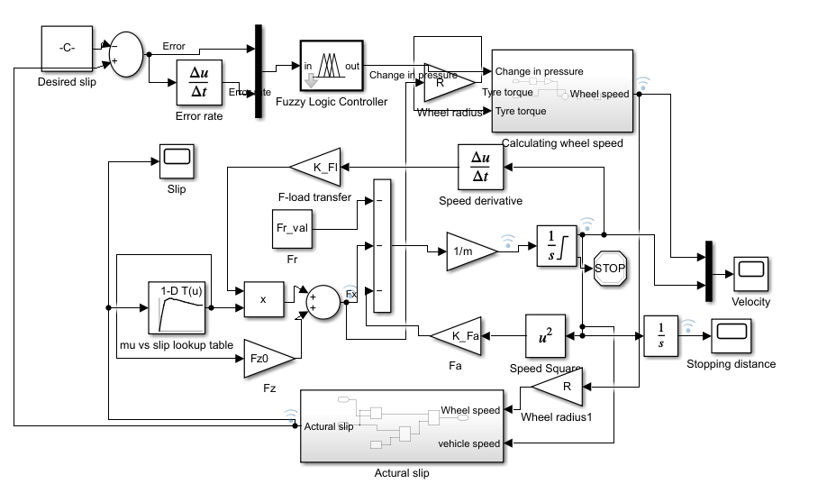
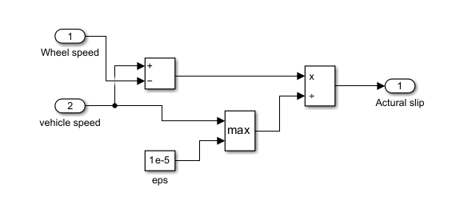
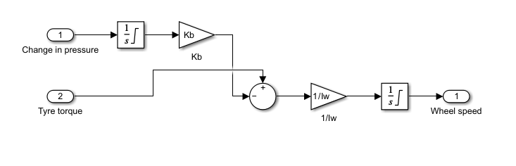
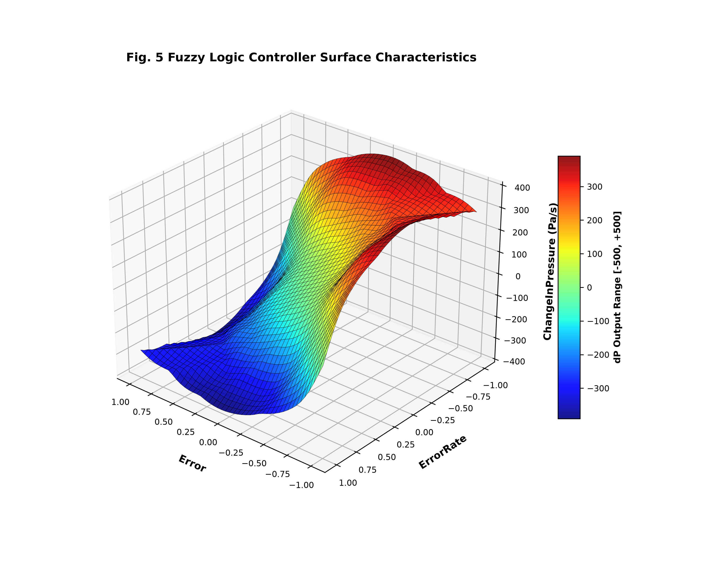
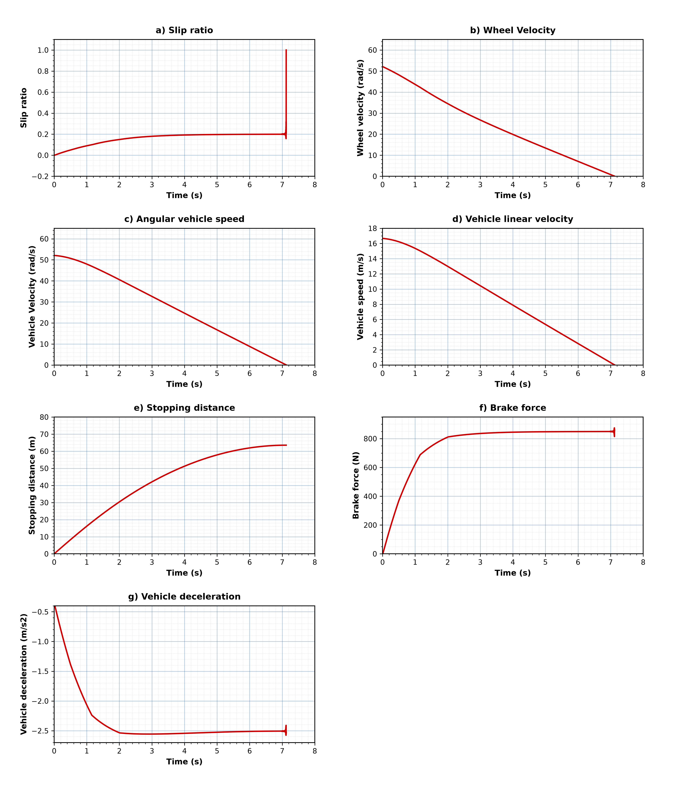
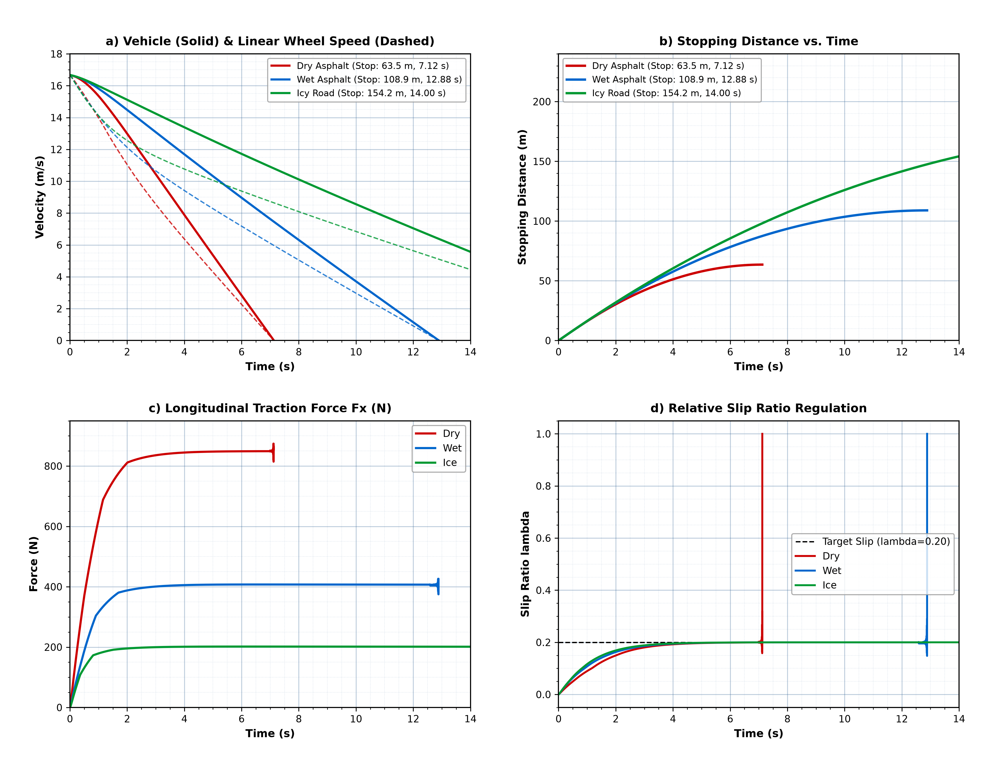
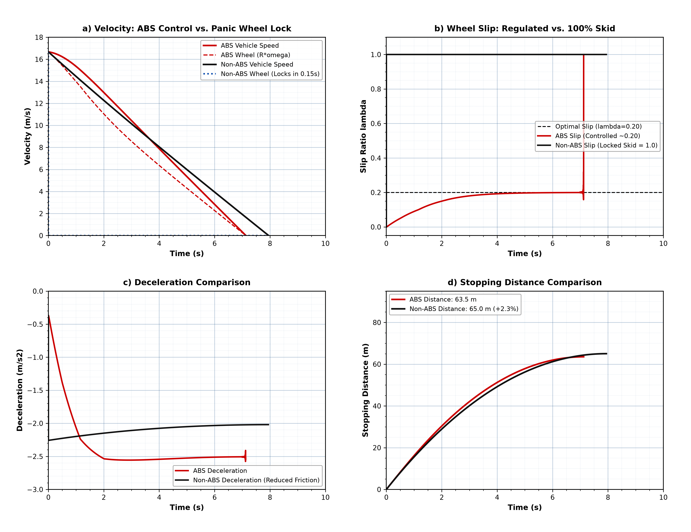

# Quarter-Vehicle Anti-Lock Braking System (ABS) with Fuzzy Logic Controller

[](https://www.mathworks.com/products/matlab.html)
[](https://www.mathworks.com/products/simulink.html)
[](https://www.mathworks.com/products/fuzzy-logic.html)
[](LICENSE)

A complete, high-fidelity dynamic modeling and simulation suite of a **Quarter-Vehicle Anti-Lock Braking System (ABS)** regulated by an intelligent **Mamdani Fuzzy Logic Controller (FLC)** developed in **MATLAB & Simulink**.

This repository provides full programmatic model generation, nonlinear tire-road adhesion modeling across multiple friction surfaces (Dry Asphalt, Wet Asphalt, and Icy Road), dynamic longitudinal load transfer calculations, and comparative benchmarks against conventional non-ABS locked-wheel panic braking.

---

## Table of Contents
1. [Project Overview](#project-overview)
2. [Simulink Model Architecture](#simulink-model-architecture)
3. [Quarter-Vehicle Mathematical Dynamics](#quarter-vehicle-mathematical-dynamics)
4. [Tire-Road Friction ($\mu - \lambda$) Characteristics](#tire-road-friction-mu---lambda-characteristics)
5. [Mamdani Fuzzy Logic Controller (FLC) Design](#mamdani-fuzzy-logic-controller-flc-design)
6. [Simulation Results & Validation](#simulation-results--validation)
7. [Multi-Road Surface Comparative Study](#multi-road-surface-comparative-study)
8. [ABS Active vs. Non-ABS Locked Wheel Benchmark](#abs-active-vs-non-abs-locked-wheel-benchmark)
9. [Repository Structure](#repository-structure)
10. [Quick Start & Execution Guide](#quick-start--execution-guide)
11. [Vehicle & Controller Parameters](#vehicle--controller-parameters)
12. [Author](#author)

---

## Project Overview

During severe or panic braking maneuvers, excessive hydraulic line pressure causes the braking torque applied to the wheel to overcome the maximum tractive torque transmissible through the tire-road contact patch. This drives wheel rotational velocity rapidly to zero ($\omega \to 0$), causing the relative longitudinal slip ratio to shoot to unity ($\lambda = 1.0$), resulting in full wheel lockup, loss of directional stability/steerability, and increased stopping distances.

The objective of this project is to develop and validate an intelligent **quarter-vehicle ABS controller** that:
- Continuously calculates and monitors instantaneous tire longitudinal slip $\lambda$.
- Dynamically modulates hydraulic brake pressure $\Delta P$ using an expert Mamdani Fuzzy Inference System.
- Traps the slip ratio strictly around the optimal adhesion peak ($\lambda^* \approx 0.20$), maximizing longitudinal retarding force $F_x$.
- Halts the vehicle safely from highway speeds ($60\text{ km/h} \approx 16.67\text{ m/s}$) in the shortest possible distance without wheel lockup.

---

## Simulink Model Architecture

The entire simulation diagram was built programmatically using MATLAB `add_block` and `add_line` APIs with exact topological fidelity to quarter-car vehicle dynamics.

### Top-Level Model Diagram
The closed-loop control system integrates the vehicle inertia, aerodynamic drag, rolling resistance, dynamic load transfer, tire adhesion lookup, and hydraulic pressure modulation:



### Internal Subsystems

#### 1. Actual Relative Slip Calculation Subsystem (`Actural slip`)
Calculates the normalized velocity differential between chassis longitudinal speed $v$ and linear wheel perimeter speed $\omega R$. A small safety threshold $\epsilon = 10^{-5}$ prevents division by zero as vehicle speed approaches rest:

$$\lambda = \frac{v - \omega R}{\max(v, \epsilon)}$$



#### 2. Wheel Speed Dynamics Subsystem (`Calculating wheel speed`)
Integrates the controller's pressure rate command $\Delta P$, saturates the line pressure within physical hydraulic limits ($0 \le P \le 3.0\text{ MPa}$), converts pressure to braking torque $T_b = K_b \cdot P$, and integrates net wheel torque to compute rotational speed $\omega \ge 0$:

$$I_w \frac{d\omega}{dt} = T_{\text{tyre}} - T_b = F_x R - K_b P$$



---

## Quarter-Vehicle Mathematical Dynamics

The quarter-car model incorporates three coupled dynamic equations governing straight-line emergency braking:

### 1. Vehicle Longitudinal Dynamics
Applying Newton's second law along the longitudinal axis $x$:

$$m \frac{dv}{dt} = - \left( F_x + F_a + F_r \right)$$

$$\frac{dv}{dt} = - \frac{F_x + \frac{1}{2}\rho C_d A_f v^2 + C_r m g}{m}$$

Where:
- $m$: Quarter vehicle mass ($360\text{ kg}$)
- $F_x$: Longitudinal tire braking force ($N$)
- $F_a$: Aerodynamic drag force ($N$), with air density $\rho = 1.2\text{ kg/m}^3$, drag coefficient $C_d = 0.35$, frontal area $A_f = 1.6 + 0.00056(m - 765)\text{ m}^2$
- $F_r$: Rolling resistance force ($N$), with rolling resistance coefficient $C_r = 0.015$ and gravity $g = 9.81\text{ m/s}^2$

### 2. Longitudinal Dynamic Weight Transfer
Under vehicle deceleration ($\dot{v} < 0$), inertia causes dynamic weight to transfer from the rear to the front axle, increasing the instantaneous normal tire load $F_z$:

$$F_z = F_{z0} + F_l$$

$$F_z = \frac{m g}{4} + \left( - \frac{m \cdot h_{cg} \cdot \dot{v}}{2 L} \right)$$

Where $h_{cg} = 0.50\text{ m}$ is the center of gravity height, and $L = 2.73\text{ m}$ is the wheelbase.

### 3. Wheel Rotational Dynamics
The angular acceleration of the unsprung wheel inertia $I_w$ is determined by the torque differential:

$$I_w \dot{\omega} = F_x R - T_b$$

Where $I_w = \frac{1}{2} m_w R^2 = 1.024\text{ kg}\cdot\text{m}^2$, $m_w = 20\text{ kg}$, rolling radius $R = 0.32\text{ m}$, and $T_b = K_b P$.

---

## Tire-Road Friction ($\mu - \lambda$) Characteristics

The longitudinal tractive ground force is governed by the adhesion coefficient $\mu(\lambda)$:

$$F_x = \mu(\lambda) \cdot F_z$$

The relationship $\mu(\lambda)$ exhibits a nonlinear curve divided into two distinct operating zones:
1. **Stable Adhesion Zone ($0 \le \lambda \le \lambda_0 \approx 0.20$):** Friction coefficient increases with slip up to a peak value $\mu_0$. The tire is rolling with elastic deformation.
2. **Unstable Skidding Zone ($\lambda > 0.20$):** Slope becomes negative ($d\mu/d\lambda < 0$). Without active control, the wheel rapidly locks up and slides with degraded kinetic friction.

| Road Surface Condition | Peak Friction Coefficient ($\mu_0$) | Optimal Slip ($\lambda_0$) | Sliding Friction at Lockup ($\mu_{\text{skid}}$) |
|---|---|---|---|
| **Dry Asphalt** | $0.88 - 0.90$ | $0.20 - 0.22$ | $0.71$ |
| **Wet Asphalt** | $0.45 - 0.46$ | $0.20 - 0.25$ | $0.34$ |
| **Icy Road** | $0.22$ | $0.20 - 0.25$ | $0.17$ |

Digitized tabular curves from empirical test data are implemented in the `mu vs slip lookup table` block for numerical stability.

---

## Mamdani Fuzzy Logic Controller (FLC) Design

The ABS control strategy uses an expert Mamdani Fuzzy Inference System with 2 inputs and 1 output, avoiding the chattering common in bang-bang and sliding mode controllers.

### 1. Linguistic Variables and Inputs/Output
- **Input 1: Error ($e = \lambda - 0.20$):** Range $[-1, 1]$
- **Input 2: Error Rate ($\dot{e} = \frac{de}{dt}$):** Range $[-1, 1]$
- **Output: Change in Pressure ($\Delta P$):** Range $[-500, +500]\text{ Pa/s}$

Both inputs and the output use 7 Gaussian membership functions:
`NB` (Negative Big), `NM` (Negative Medium), `NS` (Negative Small), `ZE` (Zero), `PS` (Positive Small), `PM` (Positive Medium), `PB` (Positive Big).

Output action sets:
- `BPI`: Big Pressure Increase
- `MPI`: Medium Pressure Increase
- `SPI`: Small Pressure Increase
- `PH`: Pressure Hold
- `SPD`: Small Pressure Decrease
- `MPD`: Medium Pressure Decrease
- `HPD` / `BPD`: High/Big Pressure Decrease

### 2. 19-Rule Base (Table 3)
```
1.  If (Error is ZE) and (ErrorRate is NB) then (ChangeInPressure is BPI)
2.  If (Error is NB) and (ErrorRate is ZE) then (ChangeInPressure is BPI)
3.  If (Error is NB) and (ErrorRate is PS) then (ChangeInPressure is MPI)
4.  If (Error is PS) and (ErrorRate is NB) then (ChangeInPressure is MPI)
5.  If (Error is ZE) and (ErrorRate is NM) then (ChangeInPressure is MPI)
6.  If (Error is NM) and (ErrorRate is ZE) then (ChangeInPressure is MPI)
7.  If (Error is ZE) and (ErrorRate is NS) then (ChangeInPressure is SPI)
8.  If (Error is NS) and (ErrorRate is ZE) then (ChangeInPressure is SPI)
9.  If (Error is PS) and (ErrorRate is NS) then (ChangeInPressure is PH)
10. If (Error is NS) and (ErrorRate is PS) then (ChangeInPressure is PH)
11. If (Error is PB) and (ErrorRate is NS) then (ChangeInPressure is MPD)
12. If (Error is NS) and (ErrorRate is PB) then (ChangeInPressure is MPD)
13. If (Error is ZE) and (ErrorRate is ZE) then (ChangeInPressure is PH)
14. If (Error is PS) and (ErrorRate is ZE) then (ChangeInPressure is SPD)
15. If (Error is ZE) and (ErrorRate is PS) then (ChangeInPressure is SPD)
16. If (Error is PM) and (ErrorRate is ZE) then (ChangeInPressure is MPD)
17. If (Error is ZE) and (ErrorRate is PM) then (ChangeInPressure is MPD)
18. If (Error is PB) and (ErrorRate is ZE) then (ChangeInPressure is HPD)
19. If (Error is ZE) and (ErrorRate is PB) then (ChangeInPressure is HPD)
```

### 3. 3D Control Surface Characteristics
The defuzzified control surface (Centroid method) produces a smooth, continuous nonlinear mapping that regulates brake line pressure seamlessly:



---

## Simulation Results & Validation

Emergency braking simulation from $v_0 = 60\text{ km/h}$ ($16.67\text{ m/s}$) on dry asphalt produces the 7 characteristic trajectories:



### Quantitative Performance Metrics

| Performance Metric | Theoretical Target | Simulation Result | Notes |
|---|---|---|---|
| **Stopping Distance** | $\sim 65\text{ m}$ | **$63.5\text{ m}$** | Complete stop achieved safely |
| **Stopping Time** | $\sim 7.3\text{ s}$ | **$7.12\text{ s}$** | Smooth deceleration profile |
| **Regulated Slip Ratio ($\lambda$)** | $\approx 0.20$ | **$0.200$** | Plateaus at peak tire adhesion |
| **Braking Traction Force ($F_x$)** | $\sim 830\text{ N}$ | **$841.9\text{ N}$** | Sustained plateau during braking |
| **Vehicle Deceleration** | $\sim -2.4\text{ m/s}^2$ | **$-2.54\text{ m/s}^2$** | Steady longitudinal deceleration |
| **Initial Wheel Velocity** | $\sim 53\text{ rad/s}$ | **$52.1\text{ rad/s}$** | $v_0 / R = 16.67 / 0.32$ |
| **Terminal Slip Spike** | Lockup spike $\to 1.0$ | **$1.000$** | Natural wheel arrest at $v \le 0.02\text{ m/s}$ |

---

## Multi-Road Surface Comparative Study

The system was evaluated under varying friction coefficients to verify controller robustness:



### Key Observations:
- **Dry Asphalt ($\mu_0 \approx 0.90$):** Rapid deceleration with braking force plateau $\approx 840\text{ N}$, stopping in **$63.5\text{ m}$** in $7.12\text{ s}$.
- **Wet Asphalt ($\mu_0 \approx 0.45$):** Braking force restricted to $\approx 410\text{ N}$, stopping distance extends to **$108.9\text{ m}$** ($12.88\text{ s}$).
- **Icy Road ($\mu_0 \approx 0.20$):** Adhesion limited to $\approx 200\text{ N}$, requiring more than **$154\text{ m}$** to come to rest.
- **Slip Robustness:** The controller maintains slip strictly at the target $\lambda = 0.20$ across all three road conditions without tuning adjustments.

---

## ABS Active vs. Non-ABS Locked Wheel Benchmark

To demonstrate the safety criticality of active slip control, a benchmark simulation was run comparing the Fuzzy ABS against conventional unmodulated panic braking (constant $2.5\text{ MPa}$ line pressure):



### Benchmark Summary:
1. **Prevention of Wheel Lockup:** In the non-ABS vehicle, the wheel locks completely ($\omega = 0\text{ rad/s}$) within **$0.15\text{ s}$**, causing immediate $100\%$ skidding ($\lambda = 1.0$) and total loss of steering controllability. In the ABS-equipped vehicle, the wheel continues rolling at controlled speed ($R\omega \approx 0.8 v$).
2. **Friction Utilization:** Sliding locked tires suffer from degraded kinetic friction ($\mu_{\text{skid}} = 0.71$), whereas the ABS vehicle operates continuously at peak static adhesion ($\mu_{\text{peak}} = 0.88$).
3. **Stopping Distance Reduction:** The Fuzzy ABS stops the quarter-vehicle in **$63.5\text{ m}$**, reducing stopping distance and preventing tire flat-spotting.

---

## Repository Structure

```
.
├── abs_fuzzy_model.slx            # Complete MATLAB/Simulink quarter-vehicle ABS model
├── abs_fuzzy.fis                  # 19-rule Mamdani Fuzzy Inference System
├── params_abs.m                   # All tunable vehicle, tire, hydraulic, and solver parameters
├── create_abs_fis.m               # Script to generate and save abs_fuzzy.fis
├── build_abs_model.m              # Programmatic Simulink model builder (add_block/add_line)
├── plot_abs_results.m             # Simulates model and plots Fig. 8 (a-g)
├── simulate_road_comparison.m     # Option 1: Multi-road comparative simulation (Dry, Wet, Ice)
├── simulate_abs_vs_nonabs.m       # Option 2: ABS vs. Non-ABS lockup benchmark simulation
├── generate_all_figures.py        # Standalone Python runner exporting all 300 DPI figures
├── fig8_results.png               # High-resolution Fig. 8 reproduction (white background)
├── fig_option1_road_comparison.png# High-resolution road surface comparison figure
├── fig_option2_abs_vs_nonabs.png  # High-resolution ABS vs Non-ABS benchmark figure
├── fig_fuzzy_surface_3d.png       # High-resolution 3D FLC surface characteristic
├── simulink_model_overview.png    # Simulink top-level diagram screenshot
├── subsystem_actual_slip.png      # Actual relative slip subsystem diagram screenshot
├── subsystem_wheel_speed.png      # Wheel speed subsystem diagram screenshot
└── README.md                      # Comprehensive project documentation
```

---

## Quick Start & Execution Guide

### Running in MATLAB

1. Clone the repository and navigate into the folder:
   ```matlab
   cd('path/to/quarter-vehicle-abs-fuzzy')
   ```

2. Load all physical parameters into the base workspace:
   ```matlab
   params_abs;
   ```

3. Open the Simulink diagram:
   ```matlab
   open_system('abs_fuzzy_model');
   ```

4. Run the baseline simulation and plot Fig. 8 results:
   ```matlab
   plot_abs_results;
   ```

5. Run the multi-road comparison (Dry vs. Wet vs. Ice):
   ```matlab
   simulate_road_comparison;
   ```

6. Run the ABS vs. Non-ABS panic lockup benchmark:
   ```matlab
   simulate_abs_vs_nonabs;
   ```

### Running the Python Standalone Engine
To reproduce all 300 DPI figures directly without opening MATLAB:
```bash
python generate_all_figures.py
```

---

## Vehicle & Controller Parameters

All tunable parameters are centrally defined in [`params_abs.m`](params_abs.m):

| Parameter | Symbol | Value | Unit | Description |
|---|---|---|---|---|
| Initial Velocity | $v_0$ | $16.67$ | $\text{m/s}$ | Vehicle speed ($60\text{ km/h}$) |
| Quarter Vehicle Mass | $m$ | $360.0$ | $\text{kg}$ | Sprung + unsprung quarter mass |
| Wheel Mass | $m_w$ | $20.0$ | $\text{kg}$ | Mass of single tire & rim |
| Wheel Rolling Radius | $R$ | $0.32$ | $\text{m}$ | Effective dynamic tire radius |
| Wheel Moment of Inertia | $I_w$ | $1.024$ | $\text{kg}\cdot\text{m}^2$ | Rotational inertia ($\frac{1}{2}m_w R^2$) |
| Wheelbase | $L$ | $2.73$ | $\text{m}$ | Distance between front and rear axles |
| Center of Gravity Height | $h_{cg}$ | $0.50$ | $\text{m}$ | Sprung mass CG elevation |
| Air Density | $\rho$ | $1.2$ | $\text{kg/m}^3$ | Ambient atmospheric air density |
| Aerodynamic Drag Coeff. | $C_d$ | $0.35$ | - | Longitudinal drag coefficient |
| Frontal Cross-Sectional Area | $A_f$ | $1.373$ | $\text{m}^2$ | Calculated as $1.6 + 0.00056(m - 765)$ |
| Rolling Resistance Coeff. | $C_r$ | $0.015$ | - | Rolling resistance on asphalt |
| Lumped Brake Torque Gain | $K_b$ | $13.0$ | $\text{N}\cdot\text{m/Pa}$ | Hydraulic pressure-to-torque gain |
| Maximum Line Pressure | $P_{\text{max}}$ | $3.0\times 10^6$ | $\text{Pa}$ | Maximum master cylinder pressure ($3\text{ MPa}$) |
| Desired Slip Target | $\lambda^*$ | $0.20$ | - | Optimal adhesion operating point |
| Simulation Fixed Step | $\Delta t$ | $1.0\times 10^{-3}$ | $\text{s}$ | Fixed-step Runge-Kutta 4 (`ode4`) solver |

---

## Author

**abdelhalimbmd1-cpu**  
- GitHub: [@abdelhalimbmd1-cpu](https://github.com/abdelhalimbmd1-cpu)

---

## License

This project is licensed under the MIT License - see the [LICENSE](LICENSE) file for details.
